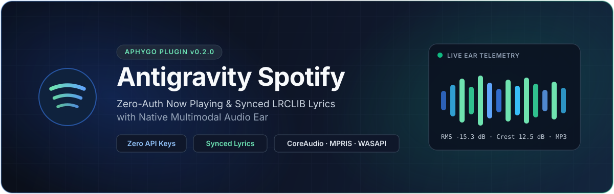
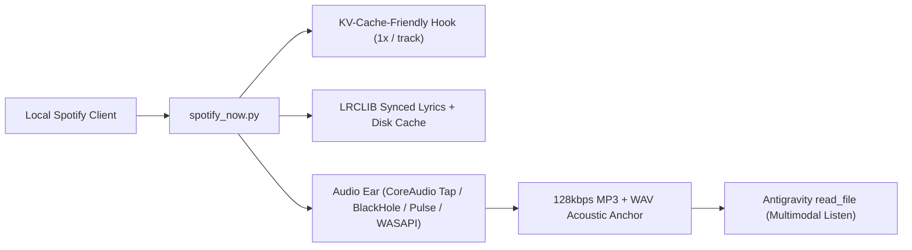

<div align="center">



<br />

# Antigravity Spotify (`antigravity-spotify`)

**Give your Google Antigravity agent real-time awareness of what is spinning on Spotify — complete with live synced lyrics and multimodal audio-ear listening, with zero API keys.**

[](plugin.json)
[](#highlights)
[](#cli--skill-quick-reference)
[](#1-command-installation)
[](LICENSE)

[Highlights](#highlights) · [How It Works](#how-it-works) · [1-Command Installation](#1-command-installation) · [CLI & Skill Reference](#cli--skill-quick-reference) · [Verification](#verified-evidence) · [Privacy](#privacy--permissions)

</div>

---

> **Keep your agent quietly in tune with the music in the room without OAuth apps, API tokens, or KV-cache churn.**
>
> **Antigravity Spotify** pairs a zero-dependency local playback bridge (`macOS JXA`, `Linux MPRIS`, `Windows SMTC`) with **KV-cache-friendly lifecycle hooks**, key-free time-synced lyrics via **LRCLIB**, and a cross-platform **multimodal audio ear** (`CoreAudio Process Tap`, `BlackHole`, `PulseAudio/PipeWire`, `WASAPI`) so your agent can inspect captured clips via `read_file` and actually *hear* the song alongside an acoustic dynamics anchor.

---

## Highlights

- **Zero-Auth Local Playback Awareness:** Reads artist, track, album, and exact playback position directly from your local Spotify desktop client — no Spotify Developer app, no OAuth tokens, and no external telemetry.
- **KV-Cache Friendly Silence (`hooks.json`):** Emits `{}` whenever Spotify is closed or paused and skips mid-tool-loop turns (`invocationNum > 1`). Whispers `🎵 [Spotify Now Playing] Artist – Track (Album) [M:SS / M:SS] | 🎤 "active lyric"` **once per track change** per conversation.
- **Live Time-Synced Lyrics (`lyrics.py`):** Queries open [LRCLIB](https://lrclib.net) with local disk caching (`30d` hit / `24h` miss), smart title cleaning (`- feat. ...`, `(Remastered)`), and exact active-line slicing at `playerPosition`.
- **Multimodal Audio Ear (`audio_ear.py` + `macos_sysaudio.swift`):** Captures a compact local `.mp3` snippet + pure-stdlib acoustic anchor (`RMS dB`, `Peak dB`, `Crest dB`, `-58 dB` silence ratio, 16-bin energy sparkline) so your agent can listen multimodally via `read_file` instead of guessing from text metadata.
- **Ambient Etiquette Rules (`rules/AGENTS.md`):** Instructs agents never to derail focused debugging or engineering work over background music, and never to claim they heard audio waveforms from metadata alone.

---

## How It Works



---

## 1-Command Installation

Clone directly into Antigravity's global plugins directory (`~/.gemini/config/plugins/antigravity-spotify`) and run the platform installer:

### Windows (PowerShell)

```powershell
git clone https://github.com/Aphygo/antigravity-spotify.git "$HOME\.gemini\config\plugins\antigravity-spotify"
& "$HOME\.gemini\config\plugins\antigravity-spotify\scripts\install.ps1"
```

### macOS & Linux (Bash / Zsh)

```bash
git clone https://github.com/Aphygo/antigravity-spotify.git ~/.gemini/config/plugins/antigravity-spotify
bash ~/.gemini/config/plugins/antigravity-spotify/scripts/install.sh
```

> **macOS Permissions Note:** On first run, macOS may prompt once for **System Settings → Privacy & Security → Automation** (reading Spotify track metadata) and **Screen & System Audio Recording** (native `macos_sysaudio` CoreAudio Process Tap capture when no BlackHole Multi-Output is active).

---

## CLI & Skill Quick Reference

| Command | Purpose | Output |
| :--- | :--- | :--- |
| `python3 scripts/spotify_now.py now [--json]` | Read active Spotify playback state, track & progress | One-line summary or structured JSON |
| `python3 scripts/spotify_now.py lyrics [--full] [--json]` | Fetch LRCLIB lyrics & slice active line at `playerPosition` | Synced window (`▶` active) or full text |
| `python3 scripts/spotify_now.py listen [--seconds 12] [--source auto\|sysaudio\|blackhole\|mic] [--json]` | Capture local audio clip + acoustic anchor metrics | `.mp3` path (`read_file` ready) + DSP anchor |
| `python3 scripts/spotify_now.py doctor` | Check OS backend, query latency, `ffmpeg`, audio devices & cache | Diagnostic checklist |
| `python3 scripts/spotify_now.py hook --event pre_invocation` | Lifecycle hook handler (`SessionStart` / `PreInvocation`) | `{"injectSteps": ...}` on track change, else `{}` |

---

## Verified Evidence

| Component | Verified Behavior | Environment |
| :--- | :--- | :--- |
| **Unit Test Suite** | **11 / 11 tests passed** (`0.234s`): duration normalization, hook deduplication, mid-loop silence, LRCLIB cache & offline mode, WAV 440Hz sine vs silent detection | `python3 -m unittest discover -s tests -v` |
| **macOS Local Query** | `pgrep -x Spotify` guard (never launches closed Spotify) + JXA readout (`~25 ms` closed, live track & position verified on *Cisza*, *DJ Cam*, *Beck*) | macOS `26.6.2` (`arm64`) |
| **LRCLIB Synced Lyrics** | Verified live `/api/get` + `clean_track_title` fallback + active-line slicing on *Keith Wallen – Teeth Marks* and *DJ Cam – Swim* | Live LRCLIB API + disk cache |
| **Native CoreAudio Tap** | `macos_sysaudio.swift` compiled cleanly (`swiftc -O`) and captured live `11.96s` stereo MP3 (`RMS -15.3 dB`, `Crest 12.5 dB`) from Spotify playback | macOS `26.6.2` (`arm64`) + `ffmpeg` |

---

## Repository Structure

```text
antigravity-spotify/
├── .gitattributes
├── .gitignore
├── LICENSE
├── README.md
├── hooks.json
├── plugin.json
├── assets/
│   ├── hero.svg
│   └── logo.svg
├── rules/
│   └── AGENTS.md
├── scripts/
│   ├── audio_ear.py
│   ├── install.ps1
│   ├── install.sh
│   ├── lyrics.py
│   ├── macos_sysaudio.swift
│   └── spotify_now.py
├── skills/
│   └── spotify-now-playing/
│       └── SKILL.md
└── tests/
    ├── test_lyrics_and_ear.py
    └── test_spotify_now.py
```

---

## Privacy & Permissions

- **100% Local Playback & Audio:** Track detection and audio clip capture run strictly on your machine; clips are capped at the latest 10 recordings under `~/.cache/antigravity-spotify/clips/`.
- **Strict Offline Mode:** Set `ANTIGRAVITY_SPOTIFY_OFFLINE=1` to disable all outbound LRCLIB lyrics requests (disk cache only).
- **Never Auto-Launches Spotify:** On macOS, `pgrep -x Spotify` runs before JXA so querying status never starts Spotify when it is closed.

---

## Credits & License

Licensed under the [Apache License 2.0](LICENSE) (`Copyright 2026 Aphygo`).

Crafted by Philip Cederman & Saga (**Aphygo**), with the 3-layer multimodal audio-perception design inspired by cousin Gry's `Grys Öra` (*"FFT:en är kryckan, inte örat"*).
